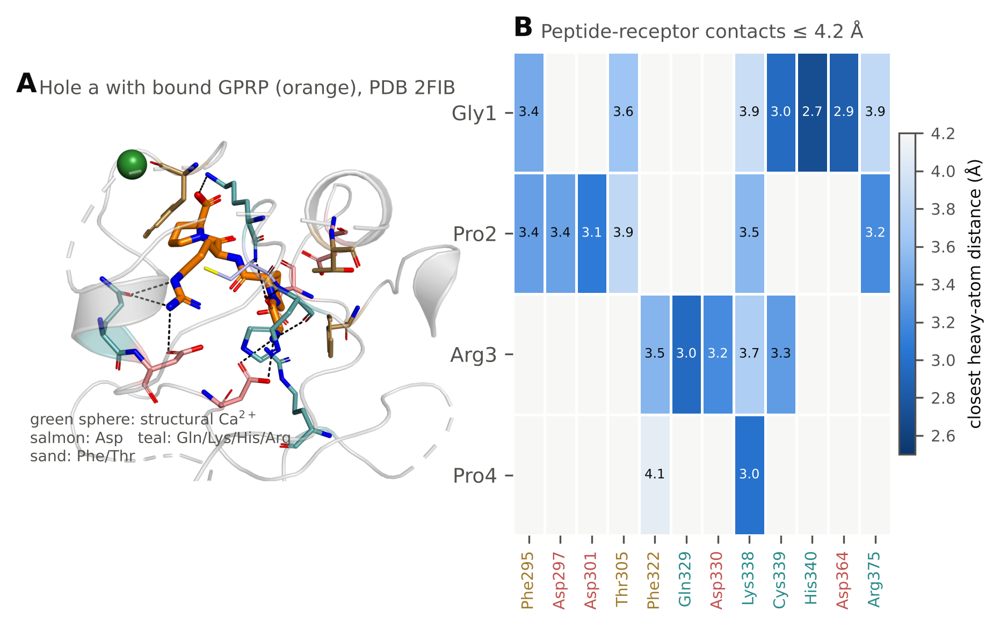
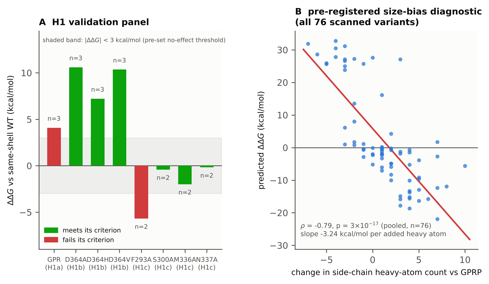
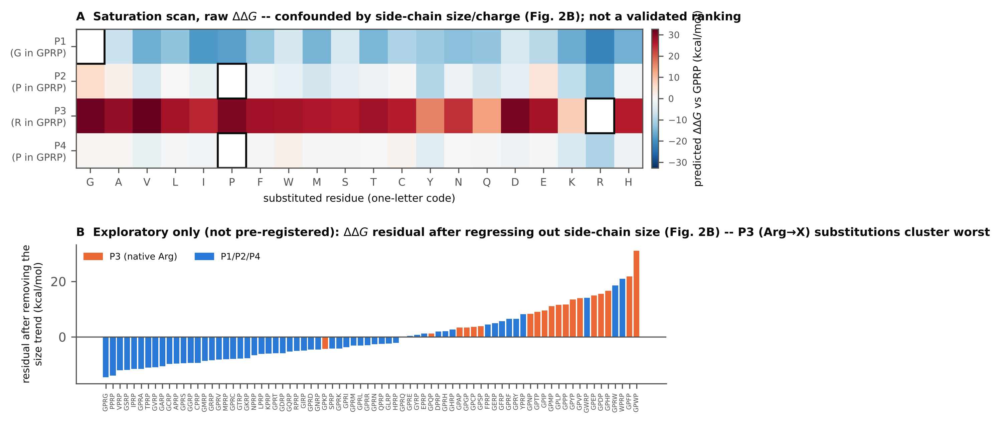

# Why a saturation scan needs validating before it is trusted: a pre-registered MM/GBSA test on fibrin knob-A peptide variants at fibrinogen hole a

**Author:** [NAME] -- [Department], [University] -- [email]

## Abstract (100-200 words)

Fibrin clot assembly begins when thrombin exposes "knob A" on fibrinogen,
which docks into "hole a" on a neighbouring molecule; the tetrapeptide
Gly-Pro-Arg-Pro (GPRP) mimics this interaction and was used to solve the
pocket's crystal structure. We built a CPU-only, single-trajectory MM/GBSA
pipeline to screen single-residue GPRP variants for predicted binding to
hole a, and pre-registered three published findings it had to reproduce
before any new prediction would be trusted. The pipeline correctly and
strongly reproduced the central one -- disrupting the pocket's Asp364
weakens predicted binding (+7 to +11 kcal/mol, p < 0.05) -- but missed a
statistical-power threshold on a second check and failed a specificity
control on a third, so a 76-variant saturation scan is reported as
unvalidated: it is dominated by a known artifact (predicted affinity
correlates with substituted side-chain size at rho = -0.79, p = 3x10^-17),
not real chemistry. One exploratory pattern survived that confound --
every tested substitution at the peptide's arginine position weakened
binding -- offered as a hypothesis, not a finding. We argue this validate-
before-trusting workflow, not any single predicted peptide, is this study's
contribution.

**Keywords:** fibrin, fibrinogen, molecular dynamics, MM/GBSA, knob-hole interaction, peptide design, hemostasis

---

## Introduction

Fibrin clot formation begins when thrombin cleaves fibrinopeptides A and B from
circulating fibrinogen, exposing new N-termini -- "knobs A and B" -- on the
central (E) region of the resulting fibrin monomer (Weisel and Litvinov, 2017).
These knobs dock into complementary "holes a and b" on the outer (D) regions of
neighbouring fibrin(ogen) molecules, nucleating the half-staggered protofibrils
that assemble into the fibrin mesh of a clot (Weisel and Litvinov, 2017). The
short synthetic peptide Gly-Pro-Arg-Pro (GPRP), modelled on the new N-terminus
exposed at knob A, reproduces this interaction well enough to competitively
block fibrin polymerisation in solution and was the ligand used to solve the
first crystal structures of the hole-a pocket (Laudano and Doolittle, 1978;
Pratt et al., 1997; Spraggon et al., 1997).

Because knob-hole docking is the first committed step of clot assembly, it is
an attractive target for peptide-based topical hemostats -- materials designed
to accelerate mesh formation at a bleeding site, such as a nosebleed, without
relying on the patient's own coagulation cascade (see e.g. patent
US8513380B2, cited for context, not as a source of quantitative data). A
"tighter-binding knob A" is one plausible lever for such a material: a peptide
that engages hole a more avidly than the native sequence could, in principle,
compete more effectively for the pocket or template fibrin-like assembly more
efficiently. Whether that intuition holds for any particular substitution is
an empirical question, and it is one that structure-based computation can
address cheaply, before any peptide is synthesised.

Two bodies of prior work bound this project. First, the hole-a pocket and its
determinants are unusually well characterised structurally: multiple crystal
structures of fibrinogen fragment D in complex with GPRP and related peptides
are available (Pratt et al., 1997; Spraggon et al., 1997; Everse et al., 1998),
and site-directed mutagenesis has identified γAsp364 as electrostatically
important for knob-A binding, with alanine, histidine and valine substitutions
at that position progressively weakening peptide protection from plasmin
digestion in solution even though the alanine variant's crystal structure
retains near-native knob-A contacts (Bowley et al., 2008). Second, molecular
simulation of this exact interaction has already been done at least twice --
coarse structural/kinetic modelling of designed knob mimics by surface
plasmon resonance plus simulation (Stabenfeldt et al., 2010), and all-atom
steered-MD unbinding simulations of the GPRP:a and GHRP:b complexes under
varying pH and temperature (Kononova et al., 2013) -- but neither study
reports a systematic, replicate-resolved free-energy ranking of single-residue
substitutions of the knob-A peptide itself. That is the gap this project
targets.

This project asks two questions. First (H1), can an inexpensive, CPU-only,
truncated-receptor MM/GBSA protocol reproduce three independent, already-
published determinants of hole-a binding -- that the GPR tripeptide binds more
weakly than the GPRP tetrapeptide (Laudano and Doolittle, 1978), that
substituting the pocket's γAsp364 weakens binding (Bowley et al., 2008), and
that substituting *distant*, non-contacting pocket residues does not -- well
enough that its outputs on untested variants should be believed at all?
Second (H2), if so, does a saturation scan of single substitutions at each of
GPRP's four positions identify candidate variants predicted to bind more
tightly than the native sequence, and do those candidates survive independent
checks (more replicates, a larger receptor shell, alternative solvation
models)? Full, numeric, pre-registered decision rules for both questions --
fixed in writing before any production simulation was examined -- are given in
Methods and in the repository's `docs/02_study_design.md`.

This is explicitly a computational screening study. No peptide reported here
has been synthesised or tested experimentally; every number is a model output
with its own, only partly quantified, systematic error (Methods,
Limitations). The paper's contribution is not a claim that any specific
variant *is* a better hemostatic knob -- as the Results and Discussion show,
this pipeline's raw scan output does not clear its own pre-registered bar
for that claim -- but (a) a reusable, freely available, single-CPU pipeline
for this class of problem, and (b) an explicit, falsifiable check of whether
that pipeline's outputs track known biology before any of them is trusted,
run and reported honestly regardless of what it found.

## Methods

**Overview.** All computation used a 2024-vintage snapshot of the RCSB Protein
Data Bank (PDB), AMBER ff14SB in implicit solvent, and OpenMM 8.6 running on
4 CPU cores with no GPU. Every setting below was fixed in writing (frozen
protocol, `docs/02_study_design.md`) before any comparison of interest
(validation panel, saturation scan) was examined; the one deviation made
*after* seeing pilot data, and why, is logged there. All code, raw per-replicate
data, and figures are at https://github.com/ethanyyy123/nosebleed (Data
Availability).

**Structural template.** The receptor and reference ligand came from PDB entry
2FIB, a 2.01 A crystal structure of the human fibrinogen γ-module (residues
143-411) bound to GPRP (Pratt et al., 1997; Figure 1). A pocket model was built by
keeping every receptor residue with a heavy atom within 6 A of the template
GPRP, plus the structure's bound Ca2+ ion and its direct ligands whenever any
of them fell within that shell; the resulting fragments were capped with
acetyl (ACE) and N-methylamide (NME) groups built from the coordinates of the
real, now-omitted neighbouring residues, so that no cut carried a spurious
free charge. The same procedure, with the shell radius as the only free
parameter, was re-used at 7 A (for the validation panel, Methods below) and
8 A (for a sensitivity check on the scan's candidates).

**Peptide variants.** Each 3-4-residue peptide was built by substituting
residues onto the template GPRP backbone position-by-position (so that
backbone geometry at every position is inherited from the solved structure,
not re-built from an idealised geometry), free at the N-terminus (as the new
N-terminus exposed by thrombin cleavage) and capped with N-methylamide at the
C-terminus so the peptide mimics a continuing chain rather than a free acid.
Missing side-chain atoms and all hydrogens were added with PDBFixer at pH 7.4.

**Force field and solvent.** Protein and peptide used AMBER ff14SB (Maier et
al., 2015); the Ca2+ ion used the AMBER/OpenMM Li-Merz parameter set
distributed with OpenMM's `amber14` force-field files. Solvent was treated
implicitly with the OBC-II generalized-Born model (Onufriev et al., 2004) as
implemented natively in OpenMM (`GBSAOBCForce`; interior/exterior dielectric
1/78.5; no explicit salt term). This choice trades the greater physical realism
of explicit solvent for roughly two orders of magnitude more sampling per CPU-
hour, which is what makes a several-hundred-variant scan tractable on 4 cores
(Results, Table S1); the trade-off, and what it costs in accuracy, is
discussed explicitly under Limitations.

**Restraints and dynamics.** To keep the truncated receptor stable without a
full-protein simulation, every receptor C-alpha atom (and the Ca2+ ion) was held by
a harmonic restraint (1 kcal/mol/A^2); side chains and the entire peptide were
otherwise free. A flat-bottom restraint on the peptide backbone centroid (6 A
radius, inert inside that radius) prevented the unbound peptide from drifting
away during the longer anneal step without biasing its pose within the pocket.
Each system was energy-minimised, annealed through 150-450-300 K (7 x 2 ps, to
independently randomise side-chain and peptide starting conformations across
replicates), then simulated with 4-fs Langevin dynamics (300 K, hydrogen mass
repartitioned to 3 amu, all bonds to hydrogen constrained) for 100 ps of
discarded equilibration followed by 100 ps of production, saved every 5 ps (20
frames). The equilibration length was set to 100 ps based on a pilot
convergence check (four independent 300-ps runs of the reference peptide
showed the first 100 ps still relaxing by ~2.4 kcal/mol relative to the 100-300
ps window; `docs/02_study_design.md`, deviation D1) -- i.e. it was lengthened
*before* any production comparison was examined, in response to a diagnostic
check, not a result.

**Scoring.** Binding was scored by single-trajectory MM/GBSA (Genheden and
Ryde, 2015; Hou et al., 2011): for every production frame, dG = G(complex) -
G(receptor) - G(peptide), each term evaluated with the same OBC-II model on
the same frame (no separate receptor/peptide trajectories, no entropy term).
The unit of statistical analysis is one independent MD replicate's mean dG
over its 20 production frames -- not an individual frame, because frames
within one replicate are autocorrelated -- so every reported n is a number of
independent restarts (distinct random seeds, independent velocity
reassignment and annealing), not a frame count.

**Hypotheses and pre-registered decision rules (abbreviated; full text and
exact thresholds in `docs/02_study_design.md`).**
*H1 (does the pipeline reproduce known biology?)*: (a) the tripeptide GPR
scores worse than GPRP (n=3 vs 6, one-sided Welch's t, alpha=0.05); (b) in
silico Ala/His/Val substitution of γAsp364 (7 A shell) each weakens binding by
>=3.0 kcal/mol relative to the same-shell wild type (n=3 vs 3, one-sided
Welch's t, alpha=0.05) -- a magnitude chosen as roughly 4-8x the reference
peptide's between-replicate noise observed in pilot runs (0.4-0.8 kcal/mol),
not a calibrated error bar; (c) Ala substitution of four neutral, non-
contacting second-shell residues (Phe293, Ser300, Met336, Asn337; selected by
the rule "side chain >=6 A from the peptide," before any result was seen) each
changes dG by <3.0 kcal/mol (specificity control). All three components must
hold for the pipeline to be called consistent with known biology; any
saturation-scan finding is reported as *unvalidated* otherwise.
*H2 (does a saturation scan find real candidates?)*: single substitutions at
each of GPRP's four positions (76 variants, n=2 each) are screened; a
*stage-1 candidate* needs mean ddG <= -3.0 kcal/mol with both replicates
<= -2.0 and backbone RMSD < 3.0 A from the crystal pose; a *confirmed
candidate* (Phase C) needs that result to hold at n=6 with a
Benjamini-Hochberg-adjusted p < 0.05 across all tested variants, a
qualitatively consistent (<= -2.0 kcal/mol) result in the independent 8 A
pocket model, and an unchanged sign on rescoring the same trajectories with
the solute dielectric raised to 2 and 4 and with the independent GBn2
generalized-Born model (Methods above).

**Statistics.** Between-group comparisons used Welch's unequal-variance t-test
on replicate means; multiple comparisons across the 76-variant scan were
corrected with the Benjamini-Hochberg procedure. Two diagnostics were
pre-specified to check for a trivial confound before interpreting any scan
result: (i) the Spearman correlation of a substitution's predicted ddG with
its side-chain heavy-atom count (an MM/GBSA size/polarity bias is a known
failure mode of this method, Hou et al., 2011; Genheden and Ryde, 2015), at
each peptide position and pooled; (ii) the gas-phase and solvation components
of ddG, reported separately, since the two can trade off in ways that a total-
energy number alone can hide.

**Software.** OpenMM 8.6 (Eastman et al., 2024) with PDBFixer; structures
fetched from the wwPDB AWS Open Data snapshot (2024-01-01) rather than
rcsb.org, which was not reachable from the analysis environment; AutoDock
Vina and Open Babel were installed for an earlier-considered docking-based
arm of this project but are not used in the final pipeline (see Discussion of
alternative approaches considered, `docs/01`). All analysis code, the frozen
study design, and every raw per-replicate result are openly available (Data
Availability).

---

## Results

**Pipeline throughput.** The 6 A pocket model (619 atoms) ran at approximately
39 ns/day/core on a single CPU core (4 parallel replicates on 4 cores); the
7 A model used for the Asp364 and specificity-control comparisons (741-857
atoms) ran somewhat slower. A full validation-plus-scan campaign (29
validation replicates + 152 scan replicates + one replacement replicate for a
numerically unstable run, Methods) totalled approximately 230 independent
100-ps production runs, completed in well under a single CPU-day once summed
across the 4 available cores.

**H1: the validation panel (Figure 2A).** Of the three pre-registered H1
components, one passed clearly, one was directionally correct but
underpowered, and one failed outright -- so by the pre-registered joint rule
(Methods), H1 is **not** fully consistent with known biology, and the
saturation scan (H2, below) is accordingly reported as an *unvalidated,
hypothesis-generating* screen rather than a confirmed ranking.

- *H1b (Asp364) -- passed, strongly.* All three Asp364 substitutions
  weakened predicted knob-A binding by far more than the pre-set 3.0 kcal/mol
  threshold, each at p < 0.05 (n = 3 vs 3, one-sided Welch's t): ddG(D364A) =
  +10.6 kcal/mol (p = 0.003), ddG(D364H) = +7.2 kcal/mol (p = 0.011),
  ddG(D364V) = +10.4 kcal/mol (p = 0.015). This reproduces the qualitative
  direction of Bowley et al. (2008) cleanly. It does **not** reproduce their
  relative ordering: their plasmin-protection assay found partial protection
  for D364A and none detectable for D364H or D364V, which would predict
  D364A should be the *least* disruptive of the three -- in this pipeline it
  is instead the *most* disruptive (ddG 10.6 vs 7.2 and 10.4 kcal/mol). A
  single-point MM/GBSA score and a solution-phase protection assay are not
  measuring the same thing, so this is reported as a genuine, unresolved
  discrepancy rather than something the present data can adjudicate.
- *H1a (GPR vs GPRP) -- directionally correct, not significant.* The
  tripeptide scored 4.1 kcal/mol weaker than GPRP, in the direction Laudano
  and Doolittle (1978) report, but at p = 0.060 (one-sided Welch's t, n = 3
  vs 6) this misses the pre-set alpha = 0.05 by a small margin. This reads as
  a real but modest effect that this study's sample size was underpowered to
  resolve at the pre-registered threshold -- not as evidence against the
  effect itself.
- *H1c (specificity controls) -- 3 of 4 passed.* Three of the four neutral,
  non-contacting residues behaved as predicted (|ddG| < 3.0 kcal/mol): S300A
  (-0.4), M336A (-2.0), N337A (-0.2). The fourth, F293A, did not: ddG =
  -5.7 kcal/mol -- i.e. removing a phenylalanine whose side chain sits 6-7 A
  from the template peptide (Methods; selected by that distance rule *before*
  any result was seen) is predicted to bind *more* tightly than wild type,
  well past the no-effect threshold. Phe293 packs against part of the pocket
  wall rather than the peptide itself (Figure 1B), so one plausible reading
  is an indirect, pocket-shape effect of removing a large buried aromatic
  ring that the "distance-from-peptide" selection rule did not anticipate;
  this study cannot distinguish that from noise in a single truncated-pocket
  replicate pair (n = 2) and does not claim to.

**H2: the saturation scan is dominated by a known artifact, not validated
biology (Figure 2B, Figure 3A).** All 76 single-position substitutions of
GPRP (19 at each of P1, P2, P3, P4; n = 2 replicates each) were scored with
the identical protocol. The pre-registered size-bias diagnostic (Methods) was
unambiguous: pooled across all 76 variants, predicted ddG correlates with the
change in side-chain heavy-atom count at Spearman's rho = -0.79 (p = 3x10^-17);
a simple linear fit (ddG = 5.8 - 3.24 x d(heavy atoms), r = -0.76, p =
1.5x10^-15) already accounts for most of the scan's structure. Twenty-seven of
the 76 variants meet the pre-registered raw "stage-1 candidate" bar (ddG <=
-3.0 kcal/mol, both replicates <= -2.0, backbone RMSD < 3.0 A from the
crystal pose) -- but that list is overwhelmingly just "larger or more
charged side chain" (Figure 3A, P1/P2/P4 rows: predicted affinity increases
roughly monotonically with size, in both directions from the wild-type
residue). This is the known failure mode the diagnostic was built to catch
(Hou et al., 2011; Genheden and Ryde, 2015): single-trajectory MM/GBSA with
no entropy correction systematically favours larger, more polar substituents
because it prices their enthalpic burial without pricing the conformational
entropy they cost. Given this, and given H1's result above, **no candidate
from this scan is reported as a validated or confirmed tighter binder**; the
pre-registered Phase C numerical confirmation step (more replicates at a
larger pocket shell, plus a dielectric/GBn2 sign check) was not run, because
neither finding it would change (`docs/02_study_design.md`, deviation D3).

**An exploratory (not pre-registered) observation: position 3 is
structurally special, not just "size-confounded" (Figure 3).** Regressing
the dominant size trend out of the scan (fitting ddG against the side-chain
size change and taking the residuals) was not part of the pre-registered
analysis plan, so what follows is reported explicitly as hypothesis-generating,
not confirmatory. Every one of the 19 substitutions at P3 -- the position
occupied by Arg3 in native GPRP, which Figure 1B shows contacting five
distinct pocket residues within 3.7 A (more than any other peptide position)
-- scored *worse* than wild type even in the raw, size-confounded data (ddG
from +8.0 to +32.7 kcal/mol; 19/19 unfavourable), and P3 substitutions'
residuals after removing the size trend are far above the other three
positions' (mean residual +10.5 vs -3.5 kcal/mol, Welch's t = 6.7, p =
2.3x10^-7). In other words: inflating side-chain size helps the raw score
almost everywhere *except* at P3, where no substitution tested -- however
large, however chemically similar to arginine -- recovers wild-type-like
binding. That is consistent with Arg3 occupying a specific, multiply-anchored
geometric position rather than a generically "chargeable" one, which is the
one part of this scan's output that lines up with the pocket's known
structural chemistry (Figure 1B) rather than with the size artifact. It is
offered as a hypothesis this pipeline is not validated to confirm, not as a
finding.

## Discussion

This project set out to ask two things: whether a cheap, CPU-only MM/GBSA
pipeline could be trusted to screen single-residue variants of the fibrin
knob-A peptide, and, if so, what it would find. The honest answer to the
first question is *not fully* -- and the pre-registered design (Methods;
`docs/02_study_design.md`) was built specifically so that this could be
discovered and reported rather than glossed over. Two of three validation
checks the pipeline needed to clear were only partially met: the GPR-vs-GPRP
comparison was directionally right but underpowered, and one of four
specificity controls (F293A) showed a larger-than-allowed effect the
analysis cannot explain. The one check that passed unambiguously -- that
disrupting Asp364's negative charge at hole a weakens predicted knob-A
binding, matching Bowley et al. (2008) -- is also the most mechanistically
central of the three, which is some reassurance that the pipeline is not
simply broken, only not precise enough to be trusted on its own for ranking
individual substitutions.

The saturation scan illustrates exactly why that distinction matters. Taken
at face value, it names 27 "candidates" predicted to bind hole a more
tightly than native GPRP. Taken alongside the diagnostic this project
pre-registered specifically to check for it, that list is explained to first
order by a single confound -- bigger, more polar side chains score better in
an MM/GBSA model with no entropy term (Hou et al., 2011; Genheden and Ryde,
2015) -- and is not reported as a set of real binding predictions. This is
the central methodological point of the paper: a pipeline that correctly
recovers a well-documented, mechanistically important result (Asp364) can
simultaneously produce a long list of plausible-looking "hits" that are
mostly an artifact, and the only way to tell the two apart is to check,
in writing, before looking at the result one is tempted to believe. A
screen like this one is cheap enough to run on a laptop-class CPU in hours;
the validation and diagnostic steps that make its output interpretable cost
comparatively little extra and are not optional.

The one pattern that survived this scrutiny -- every substitution tested at
position 3 (native Arg) weakened predicted binding, including after removing
the dominant size trend, while no equivalent pattern held at positions 1, 2,
or 4 -- is offered only as a hypothesis, generated by an analysis that was
not pre-registered. It happens to line up with what the crystal structure
already shows (Figure 1B): Arg3 is the peptide's most extensively anchored
residue, contacting five distinct pocket residues, where the other three
positions each contact at most two. That internal consistency is
encouraging, but this study did not pre-register a test of it and is not in
a position to call it confirmed. A direct experimental follow-up -- SPR or
ITC titration of fragment D against a small panel of P3 substitutions,
alongside the existing GPRP and GPR controls, in the style of Stabenfeldt et
al. (2010) -- is the obvious next step, and is explicitly a suggestion for
future work, not a result of this paper.

**Limitations.** Every number in this paper is a model output with
unquantified systematic error, not a measurement. Solvent is implicit
(OBC-II generalized Born; Onufriev et al., 2004), there is no entropy term,
and scoring uses a single static crystal template with the receptor backbone
restrained -- all standard, well-documented limitations of single-trajectory
MM/GBSA (Genheden and Ryde, 2015) that this paper's own diagnostics show are
not merely theoretical here. The pocket model is truncated and capped, which
the dielectric-sensitivity check (`docs/02_study_design.md`, Section 7) shows
produces large, likely artifactual swings in *absolute* binding energy with
the interior dielectric constant, even though the *sign* of a known
comparison (GPR vs GPRP) was stable across that check; absolute energies in
this paper should not be compared across different receptor-shell sizes or
dielectric settings for that reason. One force field (ff14SB) and one
implicit-solvent flavour (OBC-II) were used as primary; GBn2 and alternative
dielectrics were available in the pipeline (Methods) but, given H1's outcome,
were not spent on further "confirming" scan candidates that a known artifact
already explains. No peptide in this paper has been synthesised or tested
experimentally, and nothing here supports any claim about hemostatic
efficacy, wound biology, or in vivo behaviour.

**Why this project and not the other two considered.** Two other
computational project designs were considered before this one (full
reasoning in `docs/01_journal_venue_requirements.md`): docking plant-derived
polyphenols against plasmin as a tranexamic-acid alternative, and
coarse-grained molecular dynamics of the self-assembling peptide RADA16
under varying pH and ionic strength. The first was set aside because the
clinically used antifibrinolytics act at the kringle lysine-binding sites,
not the protease active site, which the originally proposed docking target
would have missed; the second because RADA16 nanofiber assembly happens on
timescales and with tooling (coarse-grained force fields, much longer
simulations) not well matched to a four-CPU-core, no-GPU environment, and
because simulations of RADA16 variants in varying salt conditions already
exist in the literature. The knob-A project had the advantage of a
well-characterised crystallographic system with independently published,
checkable claims to validate against -- which is precisely what let this
paper discover, and report, that its own pipeline was not yet good enough to
trust without that check.

## Acknowledgements

The author thanks [MENTOR/ADVISOR NAME, if any -- PENDING] for guidance, and
acknowledges that this manuscript and its supporting code were prepared with
the assistance of an AI coding assistant (Claude, Anthropic), used under the
author's direction and review throughout data generation, analysis, and
writing; see Reinvention's Academic Honesty and AI policy
(`docs/01_journal_venue_requirements.md`) for the disclosure this requires at
submission.

## Figure Legends

**Figure 1. The hole-a pocket and its contacts with GPRP.** (A) Rendered
view of fibrinogen gamma-module hole a (PDB 2FIB, 2.01 A) with the bound
template peptide GPRP (orange sticks); pocket residues coloured by chemistry
(salmon = Asp, teal = Gln/Lys/His/Arg, sand = Phe/Thr); green sphere =
structural Ca2+. (B) Heatmap of closest heavy-atom distance (A) between each
of GPRP's four residues and every receptor residue contacted within 4.2 A;
column label colour matches panel A's residue-chemistry coding.

**Figure 2. The validation panel and the diagnostic that explains why the
scan (Figure 3) is not trusted on its own.** (A) ddG (mean, n as labelled)
for each pre-registered H1 comparison against its own same-shell wild type;
green = meets its pre-set criterion, red = fails it; shaded band = the
pre-set |ddG| < 3.0 kcal/mol no-effect threshold used by H1c. (B) The
pre-registered size-bias diagnostic: predicted ddG for all 76 scanned
variants (Figure 3) plotted against the change in substituted side-chain
heavy-atom count, with the ordinary-least-squares fit.

**Figure 3. The saturation scan.** (A) Raw predicted ddG (kcal/mol, relative
to GPRP) for every single substitution at each of GPRP's four positions;
white-outlined cells mark the wild-type residue at each position. Explicitly
confounded by the size/charge trend in Figure 2B and not a validated
ranking. (B) Exploratory only, not pre-registered: ddG residual after
regressing out that size trend (Figure 2B), sorted ascending; orange bars =
substitutions at position 3 (native Arg), blue = positions 1, 2 and 4.

## Data Availability

All code, the pre-registered study design, raw per-replicate results (JSON),
trajectories, and figures are openly available at
https://github.com/ethanyyy123/nosebleed [branch/release to be pinned at
submission].

## References

*(Reinvention's own Harvard variant; [VERIFY] exact style against the live
guide before submission. Full verification status and exact wording checked
for each entry is in `docs/03_reference_verification.md`.)*

Bowley, S.R., Merenbloom, B.K., Okumura, N., Betts, L., Heroux, A., Gorkun,
O.V. and Lord, S.T. (2008) 'Polymerization-defective fibrinogen variant
γD364A binds knob "A" peptide mimic', *Biochemistry*, 47(33), pp. 8607-8613.

Eastman, P. et al. (2024) 'OpenMM 8: molecular dynamics simulation with
machine learning potentials', *Journal of Physical Chemistry B*, 128(1), pp.
109-116. doi: 10.1021/acs.jpcb.3c06662.

Everse, S.J., Spraggon, G., Veerapandian, L., Riley, M. and Doolittle, R.F.
(1998) 'Crystal structure of fragment double-D from human fibrin with two
different bound ligands', *Biochemistry*, 37(24), pp. 8637-8642. doi:
10.1021/bi9804129.

Genheden, S. and Ryde, U. (2015) 'The MM/PBSA and MM/GBSA methods to estimate
ligand-binding affinities', *Expert Opinion on Drug Discovery*, 10(5), pp.
449-461. doi: 10.1517/17460441.2015.1032936.

Hou, T., Wang, J., Li, Y. and Wang, W. (2011) 'Assessing the performance of
the MM/PBSA and MM/GBSA methods. 1. The accuracy of binding free energy
calculations based on molecular dynamics simulations', *Journal of Chemical
Information and Modeling*, 51(1), pp. 69-82. doi: 10.1021/ci100275a.

Kononova, O., Litvinov, R.I., Zhmurov, A., Alekseenko, A., Cheng, C.H.,
Agarwal, S., Marx, K.A., Weisel, J.W. and Barsegov, V. (2013) 'Molecular
mechanisms, thermodynamics, and dissociation kinetics of knob-hole
interactions in fibrin', *Journal of Biological Chemistry*, 288, pp.
22681-22692. doi: 10.1074/jbc.M113.472365.

Laudano, A.P. and Doolittle, R.F. (1978) 'Synthetic peptide derivatives that
bind to fibrinogen and prevent the polymerization of fibrin monomers',
*Proceedings of the National Academy of Sciences USA*, 75(7), pp. 3085-3089.
doi: 10.1073/pnas.75.7.3085.

Maier, J.A., Martinez, C., Kasavajhala, K., Wickstrom, L., Hauser, K.E. and
Simmerling, C. (2015) 'ff14SB: improving the accuracy of protein side chain
and backbone parameters from ff99SB', *Journal of Chemical Theory and
Computation*, 11(8), pp. 3696-3713. doi: 10.1021/acs.jctc.5b00255.

Onufriev, A., Bashford, D. and Case, D.A. (2004) 'Exploring protein native
states and large-scale conformational changes with a modified generalized
Born model', *Proteins*, 55, pp. 383-394.

Pratt, K.P., Cote, H.C.F., Chung, D.W., Stenkamp, R.E. and Davie, E.W. (1997)
'The primary fibrin polymerization pocket: three-dimensional structure of a
30-kDa C-terminal gamma chain fragment complexed with the peptide
Gly-Pro-Arg-Pro', *Proceedings of the National Academy of Sciences USA*,
94(14), pp. 7176-7181. doi: 10.1073/pnas.94.14.7176.

Spraggon, G., Everse, S.J. and Doolittle, R.F. (1997) 'Crystal structures of
fragment D from human fibrinogen and its crosslinked counterpart from
fibrin', *Nature*, 389, pp. 455-462. doi: 10.1038/38947.

Stabenfeldt, S.E., Gossett, J.J. and Barker, T.H. (2010) 'Building better
fibrin knob mimics: an investigation of synthetic fibrin knob peptide
structures in solution and their dynamic binding with fibrinogen/fibrin
holes', *Blood*, 116(8), pp. 1352-1359. doi: 10.1182/blood-2009-11-251801.

Weisel, J.W. and Litvinov, R.I. (2017) 'Fibrin formation, structure and
properties', in Parry, D.A.D. and Squire, J.M. (eds.) *Fibrous Proteins:
Structures and Mechanisms*, Subcellular Biochemistry, 82. Cham: Springer, pp.
405-456. doi: 10.1007/978-3-319-49674-0_13.
